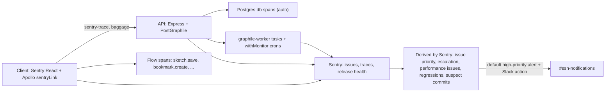

# Observability Foundation (Sentry-first)

## Setup

- `git worktree add ../seasketch-observability -b feature/observability` from `master`.
- Authenticate the Sentry integration once at the start of implementation. The DSNs in the `.env` files only allow sending events, so they can't read issues or quotas. With access, review the current top issues and check that the quota comfortably fits 100% of errors and (for now) 100% of traces.

## What is wrong today

- **Client** ([packages/client/src/index.tsx](packages/client/src/index.tsx)) runs `@sentry/react` v6 with `tracesSampleRate: 1.0` and does no filtering. It never calls `captureException`. The Apollo `onError` link ignores GraphQL errors. No project context is attached to events.
- **API** ([packages/api/src/server.ts](packages/api/src/server.ts)) runs `@sentry/node` v7, and `Sentry.init` is called a second time in [packages/api/src/visitorMetrics.ts](packages/api/src/visitorMetrics.ts). No release is set and no sourcemaps are uploaded.
- [packages/api/src/plugins/sentryPlugin.ts](packages/api/src/plugins/sentryPlugin.ts) rebuilds each error as `new Error(err.message)`. That discards the stack trace, the Postgres error code, and the constraint and detail fields. Every error lands in a single generic group, so the events can't be acted on.
- CORS `allowedHeaders` (server.ts lines 87-99) does not allow `sentry-trace` or `baggage`, so traces cannot cross from the browser to the API.
- Several flows swallow errors entirely:
  - `InviteList.tsx` has no error handler on `sendInvites`.
  - `SurveyApp.tsx` passes `onError: () => {}`.
  - `InviteUsersModal.tsx` only does `.catch(console.error)`.
  - Clipping (preprocessing) failures in the sketch editor only appear in the UI.

## Target architecture

## Approach: Sentry's defaults, not custom configuration

Sentry's recommended setup asks the application to send well-formed events and leaves interpretation to Sentry. Each event should have a stack trace, a release, an environment, the user, the correct `level`, and spans with standard ops. From those, Sentry derives most of what we would otherwise configure by hand:

- **Issue priority** comes from the event level: error and fatal start as High, warning as Medium, and info or debug as Low. Every new project already has the rule "Send a notification for high priority issues", which fires on new and escalating high-priority issues. So the `level` we choose is our alerting policy, and it lives in reviewed code rather than in Sentry's settings.
- **Escalating issues:** archiving an issue "until escalating" silences it until its volume rises above Sentry's forecast. That is the triage tool for noise; no filter rules are needed.
- **Performance issues** are detected automatically and are created as ordinary issues with a priority: slow database queries, N+1 queries, consecutive database queries, large payloads, and endpoint regressions (Sentry's detector for p95 regressions). This replaces hand-written slow-query wrappers and latency budgets.
- **Insights** pages (Queries, Outbound API requests, Web Vitals, Backend) fill in automatically when spans use the SDK's standard ops (`db`, `http.client`, `pageload`, and so on).
- **Release health and suspect commits** follow from setting `release`, uploading sourcemaps, and associating commits with the release.
- **Crons** monitors are created from code with `Sentry.withMonitor(slug, fn, monitorConfig)`, which creates or updates the monitor on each check-in. Missed or failed runs become issues.

Rules this branch follows (about 30 users a day):

- **Never sample or drop errors.** Errors stay at `sampleRate: 1.0`, and there are no `ignoreErrors` or `denyUrls` lists. `beforeSend` never returns `null` for an error.
- **Use the level instead of filters.** Known noise (browser extensions, ResizeObserver errors, aborted map tile requests, failures while offline) is sent at `info` level and tagged `noise:<kind>`, so it becomes Low priority. Expected errors (permission denied for anonymous users, validation errors shown to the user) are sent at `warning` and tagged `expected:true`, so they become Medium. Real failures are sent at `error`, so they become High and alert.
- **Only non-error data may be throttled:** traces and replays of sessions with no error. These start at or near 100%.
- **Custom grouping only where stack traces can't separate issues.** GraphQL errors all pass through the same link code, so they are grouped by operation name and error code. Everything else uses Sentry's default grouping, which works once real stack traces arrive.
- **Scrubbing removes values, never whole events.** This applies especially to survey answers and invite emails.

## 1. Client foundation

- Upgrade to the current `@sentry/react` major version and remove `@sentry/tracing`.
  - Use `reactRouterV5BrowserTracingIntegration({ history })`.
  - Keep `sampleRate: 1.0` for errors. Use a `tracesSampler` that returns 1.0 for critical flows and anything that errored, and a high baseline (1.0 for now) for everything else. The baseline is the only setting to lower if the quota ever becomes a concern.
  - Set `tracePropagationTargets` to the API host.
  - Read `environment` from `REACT_APP_SENTRY_ENV`.
  - Turn on session replay with `replaysOnErrorSampleRate: 1.0` and a small `replaysSessionSampleRate` for sessions without errors, with `maskAllText` and `blockAllMedia` enabled. Update the Sentry wording in `PrivacyPolicy.tsx` and `DataHandling.tsx` to match.
- New module `packages/client/src/observability/`:
  - `sentry.ts`: the init call, with no `ignoreErrors` or `denyUrls`. Its `beforeSend` does two things and never returns `null`:
    - Classifies known noise (browser extensions, ResizeObserver errors, `AbortError` from map tiles, network errors while offline) by adding a `noise` tag and setting `level: info`, which makes it Low priority.
    - Scrubs emails, tokens, and survey answers.
  - `context.ts`: `useSentryProjectContext()`, mounted in the project layout. It tags `project.slug`, `project.id`, whether the user is an admin, the offline state, and the service worker build.
  - `trackFlow.ts`: `trackFlow(name, attrs, fn)` wraps `Sentry.startSpan({ op: "ui.flow", name })` and sets a `flow` tag. On failure it calls `captureException` at `level: error`, which makes the issue High priority, with structured context. Network calls inside the flow keep the SDK's standard `http.client` spans so that the Insights pages fill in.
  - `sentryLink.ts`: an Apollo link that adds a breadcrumb and span for every operation. It captures every GraphQL and network error, for queries as well as mutations. Each event includes the operation name, the error code, and the variables, with personal data scrubbed and everything else kept. Errors are grouped as `["graphql", operationName, code]`.
- Wire `sentryLink` into the link chain in `index.tsx` and wrap the app root in `Sentry.ErrorBoundary`.
- Unit tests for the scrubber, the error classifier and grouping logic, and the `isX` type guards (following the repo's type-guard rules).

## 2. Critical flow instrumentation

Each flow gets a `trackFlow` wrapper and evidence attached to the event. Swallowed errors become visible to the user and are reported to Sentry.

- `sketch.preprocess` (`draw/preprocess.ts`, `SketchEditorModal.tsx`): records the endpoint, HTTP status, a snippet of the response body, the vertex count, the GeoJSON byte size, the sketch class ID, and the geography ID.
- `sketch.save` (create and update mutations in `SketchEditorModal.tsx`): records the sketch class, whether it is a collection, and the payload size.
- `forum.createTopic` and `forum.reply` (`NewTopicForm.tsx`, `ReplyForm.tsx`).
- `bookmark.create` and `bookmark.screenshot` (`PostContentEditor.tsx`, plus the API task `createBookmarkScreenshot.ts`).
- `invites.create` and `invites.send` (`InviteUsersModal.tsx`, `InviteList.tsx`): records counts only, never email addresses.
- `survey.submit` (`SurveyApp.tsx`, offline submission page): records the survey ID, the online or offline path, and the retry count. Answers are never attached.
- `upload.spatial` (`ProjectBackgroundJobContext.tsx`): records the job ID and the file type and size.
- `report.calculate` (`ReportDependenciesContext.tsx`, `useCardDependencies.tsx`): records the metric type and the error state.

## 3. API foundation

- Upgrade to the current `@sentry/node` major version, which is built on OpenTelemetry.
  - Move initialization into a new `src/instrument.ts`, imported first.
  - Replace the old request and tracing handlers with `Sentry.setupExpressErrorHandler(app)`.
  - Remove the duplicate init in `visitorMetrics.ts`.
  - Set `release` from `BUILD` and `environment` from a new `SENTRY_ENVIRONMENT` variable.
  - Keep `sampleRate: 1.0` for errors. Use the same `tracesSampler` policy as the client: everything at 1.0 for now, with a baseline that can be lowered later.
- Add `sentry-trace` and `baggage` to the CORS `allowedHeaders`.
- Rewrite `sentryPlugin.ts`:
  - Capture `err.originalError` so the stack trace survives.
  - Attach the Postgres `code`, `constraint`, `detail`, `hint`, and `table` as context.
  - Tag the operation name, the database role, and the project slug from the `x-ss-slug` header.
  - Group events as `["graphql", opName, pgCode]`.
  - Classify errors without dropping any. Expected ones (permission denied for anonymous users, user-facing `P0001` validation errors) get `expected:true` and `level: warning`, which makes them Medium priority. `57014` statement timeouts get `level: error`, which makes them High priority.
- Database performance follows Sentry's defaults:
  - The SDK's built-in `pg` instrumentation creates a `db` span for every query.
  - Sentry's Slow DB Query, N+1, and Endpoint Regression detectors then raise issues automatically.
  - There is no custom timing wrapper and no budgets file. Statement timeouts are already captured as High-priority errors.
  - Sentry receives the parameterized SQL from the instrumentation, never parameter values.
- graphile-worker (`server.ts` lines 253-329):
  - Report `captureException(error)` on every failed attempt, with the task name, attempt number, and maximum attempts as tags.
  - Attempts that will be retried are captured at `level: warning` (Medium priority). The final failure is captured at `level: error`, so it becomes High priority and alerts through the default rule.
  - Wrap scheduled tasks in `Sentry.withMonitor(slug, fn, { schedule, checkinMargin, maxRuntime })`. The monitors are defined in code and created on the first check-in; no UI setup is needed.

## 4. Release and deploy

- Changes to [.github/workflows/deploy.yml](.github/workflows/deploy.yml):
  - Use the setup that Sentry's wizard produces (`npx @sentry/wizard -i sourcemaps`): `sentry-cli sourcemaps inject` and `upload`, which match files by debug ID, for both the client and the API. Turn on `sourceMap` in the API `tsconfig`.
  - Create the API release with `getsentry/action-release` using the same `build_label`, with commits set automatically (`set_commits: auto`), so that suspect commits and release health work.
  - Set `REACT_APP_SENTRY_ENV=production` for the client build and `SENTRY_ENVIRONMENT` in the ECS environment (`GraphQLStack.ts` around lines 160-162).
- Leave Sentry disabled when `E2E_TEST_MODE` is set. For local development, support Sentry Spotlight via an optional environment flag.

## 5. One-time Sentry setup (about 10 minutes, all in the UI)

There are no custom alert rules. A short `docs/observability.md` covers the conventions in code (levels, the `flow` tag, what counts as evidence, how to add a flow) and this checklist:

1. Install the **Slack** integration and the **GitHub** integration. The GitHub integration provides suspect commits and stack-trace links into the code, and its code mappings are detected automatically.
2. In the client and API projects, open the default rule "Send a notification for high priority issues". Add the Slack action `#ssn-notifications` and keep email. This one rule covers:
   - error-level failures in critical flows, final graphile-worker failures, and statement timeouts;
   - automatically detected performance issues (slow database queries, N+1 queries, endpoint regressions);
   - missed or failed cron runs.
3. Confirm the performance issue detectors are on, under Project Settings > Performance. They are enabled by default.
4. Optional: turn on Seer for AI root-cause analysis on high-priority issues.

Triage convention: resolve issues that are fixed, and archive noisy issues "until escalating". Never delete or filter events.

Trade-off: the default rule notifies on new issues and on escalating issues, not on every occurrence. A known issue that is still open won't post again unless it escalates or regresses after being resolved. That is Sentry's intended workflow: resolving an issue re-arms its alert.

## Verification

- Client: `npm run lint` and the "Dev: client log" terminal show no errors, and codegen still works (no `import type`).
- API: `tsc` succeeds and the API unit tests pass.
- Unit tests confirm that `beforeSend` never returns `null` for an error event. Noise and expected errors must come out tagged with the correct level (`info` and `warning`), not dropped.
- Locally, trigger each flow's failure path and confirm in Spotlight or a dev Sentry environment that the event has its stack trace, tags, and context, and that one trace connects the browser to the API to Postgres.

## Deferred to a follow-up branch

- Sentry in AWS Lambdas (`@sentry/aws-serverless`) and Cloudflare Workers (`@sentry/cloudflare`).
- CloudWatch alarms and RDS Performance Insights with `pg_stat_statements`.
- Replacing or supplementing the production probe with Sentry Uptime Monitoring (which also creates issues that flow into the same default alert) and Crons.
