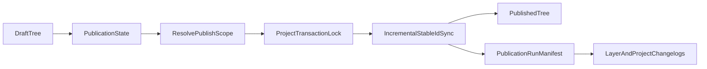

# Selective Overlay Publishing

Administrators edit only the draft overlay list. Today, [publish_table_of_contents](packages/api/schema.sql) deletes every published TOC row and recopies the entire draft tree.

Partners rejected freeze/pause and per-item context-menu publish. The settled UX is a **partial publish**: choose which unpublished overlay-list changes to include. Layers and folders that are currently published but not included remain unchanged.

Semantics, hard constraints, dependency rules, and the scenario catalog are in [design-docs/overlay-publishing/selective-publish.md](design-docs/overlay-publishing/selective-publish.md). That document is the source of truth for the todos below.

Throwaway mock to replace during implementation:

- [MockSelectivePublishModal.tsx](packages/client/src/admin/data/MockSelectivePublishModal.tsx)

`MOCK_SELECTIVE_PUBLISHING` currently blocks the real project-publish mutation so demos cannot ship the full list by accident. Remove that guard when the backend is ready.

## Product semantics

- The header Publish control is a split button. The primary action remains a full overlay-list publish review. The chevron opens **Selective publish**.
- Selective publish lists unpublished changelog rows (added, updated, removed, and z-order) with checkboxes. Confirming publishes only the selected rows.
- Unselected published layers stay at their last public version. Unselected new draft items stay absent from the public list.
- `projects.table_of_contents_last_published` remains the timestamp of the latest publish run. It is no longer the sole “what is still unpublished” boundary after selective publishes.
- After a partial publish, `draft_table_of_contents_has_changes` stays true if unpublished draft work remains.

## Settled UX

Match existing admin chrome: the shared [Modal](packages/client/src/components/Modal.tsx) and summarized-change pills from [PublishSummarizedChangesPanel.tsx](packages/client/src/admin/data/PublishSummarizedChangesPanel.tsx).

The Selective publish modal:

- Title: **Selective publish**
- Body: choose which overlay list updates to include. Currently published layers and folders not included remain unchanged.
- Grouped checkbox lists for Added / Updated / Removed / Other (z-order), including section-level select-all.
- Footer: **Publish N selected** and Cancel.

Do not add context-menu publish, pause/resume, or a paused-items card on the full Publish Overlays modal.

## Architecture

Today’s full replace cannot leave unselected public snapshots in place. Publish must become incremental by `stable_id`.

- Add a project advisory lock around every publish run.
- Keep published rows whose `stable_id` is outside the current selected scope. Delete-and-recopy only the rows in scope (published rows are immutable today).
- Record each run in a publication manifest (mode, selected scope, actor, published / skipped / deleted / failed). Do not stuff thousands of IDs into changelog JSON.
- Reuse copy helpers from `publish_table_of_contents` and update the hard-coded column lists in that function and `copy_table_of_contents_item` per [AGENTS.md](AGENTS.md). Cover folders, moves, ACLs, cloned vs shared library sources, interactivity settings, overlay data tables, deletions, report `stable_id` references, and tiles ACL rewrite ([publishTilesAclPlugin.ts](packages/api/src/plugins/publishTilesAclPlugin.ts)).
- Tests: [changelogs.test.ts](packages/api/tests/changelogs.test.ts), [tableOfContentsItems.test.ts](packages/api/tests/tableOfContentsItems.test.ts), plus overlay-data-table and data-library publish tests.

## Changelog model

- Keep one project-level `layers:published` event, extended with mode (`full` | `partial`), counts, and a publication-run id.
- Use the manifest for “what this run published or skipped.” Do not emit a changelog row per skipped item.
- Replace time-window inference in `table_of_contents_items_related_publish_change_logs` with manifest membership. Update [DraftTableOfContents.graphql](packages/client/src/queries/DraftTableOfContents.graphql) and regenerate client types.

## Implementation notes

- Work in [packages/api/migrations/current.sql](packages/api/migrations/current.sql) only.
- Client GraphQL lives in `.graphql` files; do not edit `packages/client/src/generated/*` by hand.
- No `import type` in client code.
- User-visible strings need i18n (`admin:data`).
- Remove the mock components and `MOCK_SELECTIVE_PUBLISHING` once the real mutations exist.
