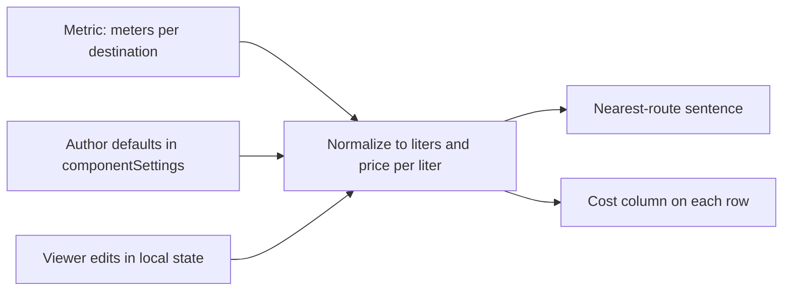

# Travel cost on the distance-to-point map

Optional section on [DistanceToPointMap.tsx](packages/client/src/reports/widgets/DistanceToPointMap.tsx). Off unless the author turns it on, so existing Distance to Port maps stay unchanged. No overlay-engine change and no new widget type. Distance to Shore and liters-per-hour are out of scope.

The metric stays `distance_to_features_over_water` (meters). Fuel math is client-only, so changing a price does not recalculate the route.

## Calculation module

New [packages/client/src/reports/widgets/travelCost.ts](packages/client/src/reports/widgets/travelCost.ts), plus `travelCost.test.ts`.

Stored settings (author defaults, persisted on the node):

- `enabled`
- `currency` — ISO 4217 code
- `volume` — `liter`, `gallon` (US), or `imperial-gallon`
- `efficiencyMode` — `distance-per-volume` or `volume-per-distance`
- `efficiencyLength` — `kilometer`, `nautical-mile`, or `mile`
- `defaultEfficiency` and `defaultPrice` — number or empty

One volume unit applies to both efficiency and price. Switching volume, length, or mode converts the stored numbers so the physical estimate stays the same. Internal formula:

- liters = `(meters / 1000) / kmPerLiter`
- one-way = liters × price per liter
- round-trip = one-way × 2, same route back

`isTravelCostSettings` takes `unknown` and rejects null, non-objects, and bad enums before any property is trusted. Currency formatting uses `Intl.NumberFormat` with `currencyDisplay: "code"` (so Fiji reads `FJD 116`). An unrecognized code does not format a cost.

No platform default for price or efficiency. Enabling the section starts from liters, efficiency length matching the map unit when that unit is km, nmi, or miles, and blank numbers. The cost sentence appears only when both numbers are finite and positive.

## Sketch-report UI

New presentational block used under the map card, outside the fixed-height map/table box in `DistanceToPointMap`, so it does not shrink the route map.

- Seed local state from the stored defaults. Viewer edits stay in that state and are not written back to the document.
- Viewers edit the two numbers. Units and currency stay as the author set them, shown as labels (for example `km/L` and `FJD/L`).
- Summary sentence uses the nearest row: cost to that place, one-way and round-trip, and that the return is the same route.
- When travel cost is on and both numbers are set, add a cost column to the existing table, one value per destination. For a collection, combine already keeps the shortest route to each point; the cost is that route, not a sum across child sketches.
- While `printing` is true, the section is expanded.

## Author tooltip

Add a **Travel cost** popover on the existing tooltip row in `DistanceToPointMapTooltipControls`, beside the basemap control. The row is already full; this group does not go inside More.

Popover contents: enable checkbox, currency text field (3-letter code, checked with `Intl`), volume, efficiency mode, efficiency length, and the two default numbers. Changing a unit converts the defaults in `componentSettings`. Copy in the popover says these are planning assumptions.

The Distance to Port slash command in [widgets.tsx](packages/client/src/reports/widgets/widgets.tsx) does not set `travelCost`. Omitted settings mean off.

## Export and docs

Extend [distanceToPointMap.export.ts](packages/client/src/reports/widgets/exports/exporters/distanceToPointMap.export.ts). When the section is enabled and both defaults are usable, each row also exports currency, efficiency, volume, price, one-way cost, and round-trip cost computed from the **stored** defaults. On-screen viewer edits are exploratory and are not in the CSV, because the exporter does not see React state.

Add a short bullet under Distance widgets in [README.md](packages/client/src/reports/widgets/README.md).

Strings go through `useTranslation("reports")` or `Trans`. Do not edit files in `packages/client/src/lang/`.

## Verification

Unit tests for the converter and the type guard: null, undefined, a non-object, a valid Fiji-shaped example (`1.5 km/L`, `2.31 FJD/L`, 76 km → about 116 one-way and 233 round-trip), volume-unit conversion, blank inputs, and a bad currency code.

After the UI is in, confirm in the running client that a distance-to-point map with the section off is unchanged, and that turning it on with those Fiji numbers shows the sentence and a per-row cost. Also check print layout keeps the section visible, and an empty price shows the inputs without a cost.
