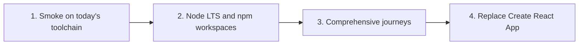

# Strategy

> Part of the [2026 campaign record](README.md). Status: design, started September 2026.

[Index](README.md)

## Goal

Four outcomes that only work together:

- A clean machine — a developer laptop, a GitHub Actions runner, or a cloud agent VM — can install, load a useful database, and start SeaSketch from documented commands.
- That default stack does not read credentials for, or write to, production systems.
- Browser tests cover the product's surface. Every push runs a tiny `@smoke` set that is not split by audience. End-user journeys and admin journeys are separate catalogs and separate CI jobs. The end-user job is the critical one. The admin job matters and is a more forgiving bar. Either integration job may take 20–30 minutes or longer. Both run on every branch push, in the same Unit Tests workflow as smoke, as their own jobs. They do not run inside the deploy workflow. The production probe is a smaller read-only check of the live site. ([journeys](journeys.md))
- Large refactors of the client build can be implemented, and those tests show whether they work before they merge.

## Starting point (2026)

**Packaging.** Lerna 6 with a hand-maintained package list, roughly thirty `package-lock.json` files, and several real packages deliberately left out of Lerna to keep `lerna bootstrap` small. Every CI job, the deploy workflow, and the production GraphQL Docker image install through a different `lerna bootstrap --scope=…` list.

**Toolchain.** Node 23 in `.nvmrc` and in the production GraphQL image (`FROM node:23`). Node 23 reached end of life in June 2025. CDK-bundled Lambdas target Node 22. TypeScript is mostly 5.5; the API is on 5.8 and `pmtiles-server` on 7.

**Client.** Create React App 4 (`react-scripts` 4). The production build needs `--openssl-legacy-provider`. ESLint extends CRA's `react-app` config. The dev server, typecheck, and lint are what make the editor slow.

**Tests.** CI runs API Jest, client Jest, overlay-engine Vitest, GraphQL schema drift, generated Tailwind CSS, and a client production build, on every push. Nothing exercises the app in a browser. Cypress specs under `packages/client/cypress` are unmaintained and no longer runnable. The repo README still describes end-to-end tests as part of merging.

**Runtime.** VS Code tasks fire on folder open and start Postgres, Redis, the API, the client, and some watchers. `db:start` returns before Postgres accepts connections, so the API races the database. Spatial uploads, data tables, tiles, and overlay workers are started by hand or, when configured, point at production. Secrets live in per-package `.env` files, and several of those values are production credentials, including an Auth0 Management API client that can update production users.

**Deploy.** A manually dispatched workflow runs migrations, deploys the API with CDK, validates client operations against the live schema (`api_ready_gate`), then publishes the client. A client-only Cloudflare preview publishes a bundle against a shared API on every push. There is no staging environment.

## The deadlock

Two loops make a "finish A, then B" plan stall.

**Packaging and tests.** Replacing Lerna and Create React App changes install order, module format, environment variables, and the production bundle. Without an integration suite, the check is unit tests plus someone clicking around, and a packaging change turns into days of broken local development. But a large Playwright effort on today's CI pays a full Lerna bootstrap and a CRA production build for every run. The suite becomes too slow to gate pull requests, people stop trusting it, and the refactor is unprotected again.

**A local stack and tests.** Journeys for uploads, tiles, data tables, and reports need those services running, and today several of them are production. Building the whole local stack before any browser test is a long project with nothing guarding it. Writing those journeys against production makes CI and cloud agents share production buckets, queues, and Lambdas.

Neither loop resolves by waiting for one side to be done. The first slice has to be small enough that both sides fit inside it.

## Approach

Hold the risky axis still. Change one axis. Prove it with the slice you already have. Then change the next axis.

Phase 1 is allowed to be slow. Its job is to exist and to fail when the core app does not boot. Phase 2 makes that job cheap enough to keep and to grow. Phase 3 writes the two catalogs, splits CI into smoke, end-user, and admin, and fills them on Create React App. Phase 4 is the dangerous compiler change, and it lands only while the end-user suite is already green. There is no phase 5 and no staging server.

## Phases at a glance

| Phase | Changes | Holds still | Gate to leave the phase |
| --- | --- | --- | --- |
| 1. Smoke | Golden snapshot, root `setup` / `dev`, `E2E_TEST_MODE`, three `@smoke` journeys, a CI job on push | Lerna, CRA, deploy | Smoke runs on push and is green; a clean VM boots the core profile |
| 2. Workspaces | Node Active LTS everywhere; npm workspaces; production build paths moved onto the workspace; dependency consolidation within majors; TypeScript project references; post-deploy production probe | CRA, product behavior | Smoke green on workspaces; the consolidation checkpoints hold; a no-product-change deploy succeeds and passes the probe |
| 3. Journeys | [End-user](journeys-end-user.md) and [admin](journeys-admin.md) catalogs iterated then implemented; CI split into `@smoke`, `@enduser`, and `@admin`; remaining Cypress scenarios ported; bundler-risk included in whichever catalog owns the screen; agent recipe | Bundler, workspace layout | Both catalogs agreed; smoke job runs only `@smoke` and stays fast; end-user suite green on CRA; admin suite green or its gaps recorded; bundler-risk green in the suite that owns it |
| 4. Client build | Replace CRA (Vite candidate); client tests and lint off CRA; the carried CRA pins deleted | Journey assertions, workspace layout | Smoke and the end-user suite green on the new build. Admin bundler-risk green. The rest of the admin suite green, or a recorded gap that does not hold the migration |

## Phase details

### Phase 1 — Smoke on the current toolchain

**Critical path**, in order:

1. The API boots with integrations unset. Auth0 management, Lambda ARNs, and queue URLs that are missing make their features unavailable instead of failing startup or calling production. ([local services](local-services.md), [Auth0](auth0.md))
   - Auth0 management: done, September 2026.
   - Lambda ARNs and queue URLs: done, September 2026. Unset targets already skipped or threw. The overlay-engine access token no longer reads the production secret when its ARN is unset outside production, and a screenshot job fails closed when its Lambda ARN is unset.
2. Golden database snapshot and `npm run setup`, which waits for Postgres, restores, and migrates forward. ([integration testing](integration-testing.md), [environment setup](env-setup.md))
   - Local create and restore: done, September 2026. `npm run snapshot:create` dumps a side database built from committed migrations, the graphile-worker schema, `demo-public`, two seed users, and a generated signing key. `npm run setup` restores that local file into an empty database and migrates forward. A database that already has migrations is left in place; `npm run setup -- --reset` replaces it. The dump is gitignored.
   - R2 fetch and the data library: done, October 2026. The dump seeds a hardcoded Seamounts template (public tile URL, cartography, citation, and popup), plus the four geography templates the create-project form offers, each with its production upload outputs so geography size metrics and overlay analysis work. It does not carry the rest of the production catalog. Outside production the cleanup worker will not delete objects owned by the `superuser` project. `npm run snapshot:publish` uploads the dump to `golden-snapshot/current/` in the tiles bucket. `npm run setup` downloads it from `https://uploads.seasketch.org` when the local copy is missing or older, with no credentials.
   - Default basemaps on the public fixture: done, October 2026. The fixture calls `add_default_basemaps`, the same function `create_project` uses.
   - `demo-samoa` follows create-project: done, October 2026. It has the Exclusive Economic Zone, Territorial Seas, and Offshore geographies for Samoa (`MRGID_EEZ` 8445), cloned into the project, nested under Geography layers, and published. The map extent is that EEZ, not the global default. Samoan is enabled as an alternate language.
3. `E2E_TEST_MODE` in the API. ([integration testing](integration-testing.md))
   - Done, October 2026. `POST /e2e/token` exchanges a known `sub` and `E2E_TEST_PASSPHRASE` for an access token signed with the API's own keys under `https://e2e.seasketch.test/`. The auth middleware trusts that issuer only while the mode is on, and startup refuses the mode unless `NODE_ENV` is `development` or `test`, and when the database host is RDS or `CLIENT_DOMAIN` is `seasketch.org`. Only `e2e|` users can sign in, superuser or not. Management lookups and email verification use the local `users` table. Project invite, survey invite, and verification email is written to `e2e-emails/` instead of SES. The golden snapshot no longer carries a signing key; `setup` generates one per database.
4. `packages/e2e` with three `@smoke` journeys.
   - Done locally, October 2026. `npm run e2e` runs them headless, `npm run e2e:headed` shows the browser, and `npm run e2e:ui` opens Playwright's interactive runner. Sign-in writes the Auth0 SPA localStorage cache and session cookie; the client bundle is unchanged and Auth0 is not called. The API has to be in test mode.
5. A CI job that restores, builds, and runs `@smoke` with the other test jobs.
   - Done, October 2026. The Smoke tests job in `.github/workflows/unit-tests.yml` runs on push. It restores the golden snapshot, builds the API, and runs against the client dev server. It is not part of the deploy workflow. The run's Smoke Test Output check lists the journeys. The `playwright-report` artifact has the HTML report, and screenshots, video, and traces when a journey fails. *(November 2026)* The job runs `npm run e2e:smoke` (`--grep @smoke`) only. End-user and admin are separate jobs in the same workflow. None of the three is a deploy gate. Smoke stays one job and is not split by audience.

**Alongside, not blocking the gate:** the non-production Auth0 tenant ([Auth0](auth0.md)) and the first slice of the secrets manifest and its fail-closed check ([secrets](secrets-management.md)). They are phase 1 exit criteria because a cloud agent should not be handed secrets until they exist, but the smoke job does not wait for them. Both shipped October 2026. Process supervision shipped October 2026 ([environment setup](env-setup.md)): Compose for containers, `concurrently` for host processes.

**Holds still.** Lerna, Create React App, the deploy workflow, and every service outside the core profile.

**Exit.** Smoke runs on push with the other tests and reports each journey. It is not a required status check. The smoke job holds no Auth0 secrets. A clean VM — including a cloud agent — runs `setup` and `dev` without VS Code or a shell profile, using only non-production credentials. A person can open a fixture project by logging into the non-production tenant. *Done, October 2026.* The smoke job copies the templates, which point at `seasketch-dev`, and receives no Auth0 credentials. Login uses that tenant.

### Phase 2 — Node LTS and workspace packaging

Two separate changes, each its own pull request and its own production deploy.

**Node.** Move to the current Active LTS in `.nvmrc`, `engines`, CI, the production GraphQL image, and CDK Lambda targets. This is a runtime change in production, so it does not ride along with packaging.

**Workspaces.** npm workspaces, one root lockfile, one TypeScript for application packages, root scripts, and a policy for checked-in build output. The production build paths move with it: the deploy workflow's install steps, the GraphQL image's Lerna scope list, and the CDK Lambdas that bundle against per-package lockfiles. ([monorepo and build](monorepo-and-build-upgrade.md)) *Done, October 2026.* The production probe still runs on the first deploy of this change.

**Dependency consolidation.** *(October 2026)* The first workspace install exposed what the separate lockfiles had hidden: three copies of `graphql`, three of React, five `vitest` ranges, eight `@types/node` majors, duplicated ProseMirror and Apollo. Pinning them back made CI pass; it did not consolidate anything. The same pull request continues to one version of each shared library and one range per tool, moving within major versions only, and regenerates the GraphQL schema, the client's generated types, and the Tailwind output where a printer or version changed them. TypeScript project references land here too, so `tsc -b` of one package builds only its dependencies and CI builds the target it tests. Pins that exist only because Create React App cannot load a current package are kept and listed as temporary. The steps, the carried-pins table, and the completion checkpoints are in [monorepo and build](monorepo-and-build-upgrade.md).

A single pull request for workspaces and the bundler was considered and rejected; the reasons are recorded there. In short: it would deploy three changes to production at once with only the probe as a safety net, make a failing journey unattributable, and hold the lockfile open against `master` through the phase 3 work.

**Production probe.** This is the first phase that changes production artifacts, and this campaign does not add a staging server. So the read-only `@production` probe (homepage, a public project, API health) lands here and runs after every deploy. ([integration testing](integration-testing.md))

**Holds still.** Create React App, product behavior, and the shape of the deploy workflow and CDK stacks. Only their install and bundling inputs change. Dependency versions may move within their majors, and committed generated artifacts may be regenerated, with the diff explained. Editor relief that needs no new bundler — TypeScript project references, ESLint caching — lands here.

**Exit.** Smoke is green on the workspace layout, and its install time is recorded against the Lerna baseline. The consolidation checkpoints in [monorepo and build](monorepo-and-build-upgrade.md) hold. A deploy with no product change succeeds through the normal workflow and passes the probe. Day-to-day `npm install` at the root replaces per-package bootstraps.

If this phase slips, new journeys do not pile onto the pull-request smoke job. End-user journeys go to the end-user job. Admin journeys go to the admin job.

### Phase 3 — Comprehensive journeys

**Changes.** Iterate the [end-user catalog](journeys-end-user.md) and the [admin catalog](journeys-admin.md), then implement them as Playwright tests on Create React App. Fill the end-user catalog first. Split CI into three jobs: `@smoke` on every push, then `@enduser` and `@admin` as separate integration runs on every branch push. Smoke is not tagged as either audience. Port the remaining Cypress scenarios (Auth0 signup is the last access hole; it is an end-user journey). Bundler-risk items stay in the catalog that owns the screen. Write the agent recipe so a later change ships with a journey in the right suite. Offline support gets a downstream plan before those items are farmed, end-user offline first. ([integration testing](integration-testing.md), [journeys](journeys.md))

*(October–November 2026)* Access gates, local data services, uploads, overlay reports, and several map-shell journeys already exist. Access, forums, surveys, and the participant report count as end-user. Uploads, changelog, selective publish, and the admin seed lists count as admin. Phase 3 is filling the rest and teaching CI the three jobs, not starting from zero.

*(October 2026)* The data profile's production groundwork (raw uploads on R2, self-contained storage URLs) and the local stand-ins (uploads, tiles, overlay, fragments, sketch preprocessing) already shipped. They stay the runtime the data, sketch, and report journeys use. ([local data services](local-data-services.md))

The Vite spike may begin on a throwaway branch during this phase so its findings shape which bundler-risk journeys matter most. It does not merge here.

**Holds still.** The client bundler and the workspace layout.

**Exit.** Both catalogs have been iterated and are the lists agents implement against. The push job runs only `@smoke` and finishes quickly. The end-user suite is green on Create React App, including its bundler-risk rows (or a recorded decision to drop one, such as offline surveys). The admin suite is green, or a gap is written into the admin catalog and is not treated as blocking the end-user gate. Admin bundler-risk (uploads, style editor, metadata, report-card insertion) is green. Cypress leftovers are gone once their catalog items exist. The agent recipe is linked from `AGENTS.md`. A change to spatial uploads, data tables, or report calculation can still be tried without deploying a Lambda.

The end-user suite is the gate before phase 4. Participant-facing access changes need it too. Admin-screen work uses the admin job and does not have to be as strict.

### Phase 4 — Client build replacement

**Changes.** Replace Create React App; Vite is the candidate. Client unit tests and ESLint move off CRA's configuration. Smoke, the end-user suite, and the admin suite run as the same three jobs against the new dev server and the new production build. *(October 2026)* The pull request deletes the pins phase 2 carried for webpack 4 and Jest 26, and moves the client's own dependencies to current releases within their majors as those pins come off. ([monorepo and build](monorepo-and-build-upgrade.md))

**Holds still.** Journey assertions and the workspace layout. A pull request in this phase does not restructure packages.

**Exit.** Smoke and the end-user suite are green on the new build, including end-user bundler-risk. Admin bundler-risk is green. The rest of the admin suite is green, or a recorded gap remains a gap and does not hold the migration. The client preview workflow has published the new build to a real host before the first production deploy. `--openssl-legacy-provider` is gone, and the carried-pins table is empty. The client dev server and the CI client build are materially faster.

## Risk without a staging server

Phases 2 and 4 change production artifacts. This campaign does not add a staging environment. The mitigations are what already exists plus what phase 2 added:

- The end-user suite, on Create React App before the bundler changes and on the new build after, is the characterization test for the product people use. The admin suite is the separate check for the admin UI, including the editors a bundler swap breaks. Smoke is only the fast gate, and it is not split into those two audiences.
- The client preview workflow publishes each build to a real host.
- The deploy workflow's `api_ready_gate` already refuses to publish a client whose operations the live API rejects.
- From phase 2, the `@production` probe runs after every deploy and every 30 minutes.
- Rollback is re-running the deploy workflow on the previous commit, as the repo README describes.

A hosted staging stack is out of scope. Cloud agents running `setup` and `dev` from the same contract remain the isolated place to try a change. The client-only preview workflow is not staging and does not become it.

## Rules

- A pull request changes one axis. Node, workspaces, and the client bundler never share a pull request. A journey and a large refactor share one only when the journey is the characterization test for that refactor. *(October 2026)* Dependency versions within a major, regenerated artifacts, and TypeScript project references are part of the workspaces axis, not a fourth one; they ride with it.
- *(November 2026)* `@smoke` runs on every push, with a report and a trace when it fails. It is three journeys, not split into end-user and admin. The end-user job (`@enduser`) and the admin job (`@admin`) are separate jobs in `.github/workflows/unit-tests.yml`, written out beside Smoke tests so the check list shows each name. One push is one workflow run. A matrix was removed the same day because GitHub collapses those cells. They run on every branch push. A same-day limit to `master`, and a same-day separate workflow, were both replaced. Create Deployment does not wait on this workflow. A red end-user job is the one reviewers treat as the product being broken. A red admin job is a separate regression and a more forgiving bar. None of the three gates a deploy. Failing smoke is not skipped to make a migration look green.
- A journey depends only on services the root start command runs for its profile. A journey that needs a production Lambda is not a local test.
- The default configuration never points at production. A production override is explicit, per integration ([local services](local-services.md)), and absent from CI.
- Agents are normal consumers of the contract. Commands are non-interactive, logs are attributable to a service, and failure paths are written down. Agents may restore the golden snapshot; they may not publish one unless the task is a snapshot refresh.
- Choices left open — the exact Vite setup, the offline-support harness — are settled by a short spike at the start of the work that needs them, against the criteria in the topic file, and then recorded there. The process supervisor was settled in October 2026 ([environment setup](env-setup.md)). Offline journeys are not farmed until that plan exists ([journeys](journeys.md)). End-user offline is planned before admin tile packages.
- When a choice would force a fork to run a second production SeaSketch, prefer "same revision, different configuration" ([second production install](second-install.md)).

## What this campaign leaves alone

- API Jest, client unit tests, and overlay-engine Vitest remain the breadth layer for permissions and numeric overlay accuracy. Browser tests are the journeys in the catalog, not a second copy of every API case.
- The deploy workflow's structure and the CDK stacks' resources. Phase 2 changes how they install and bundle; it does not redesign deployment.
- The client preview workflow keeps publishing a bundle. It is not turned into staging.
- We do not write a process supervisor, a secrets store, or a test framework.
- We do not replay the full migration history on every CI run or new laptop once a snapshot exists.
- We do not stand up a staging server or a second production site.

## How topic files are organized

Each topic file has the same sections: **Intent**, **Starting point (2026)**, the design itself, **Decisions**, **Open questions** (each tagged with the phase whose spike resolves it), and **Exit criteria** by phase.

*Starting point* stays the baseline. It is not edited as work lands. *Decisions* are accepted choices; a choice that has shipped gets the month, and one without a month is still open. A met exit criterion is marked *Done, <month>* in place, not struck through. A *Progress* table is only for a decision that is partly shipped. Resolved open questions move into *Decisions* ([keeping this record](README.md#keeping-this-record)).
