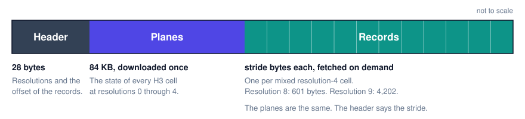
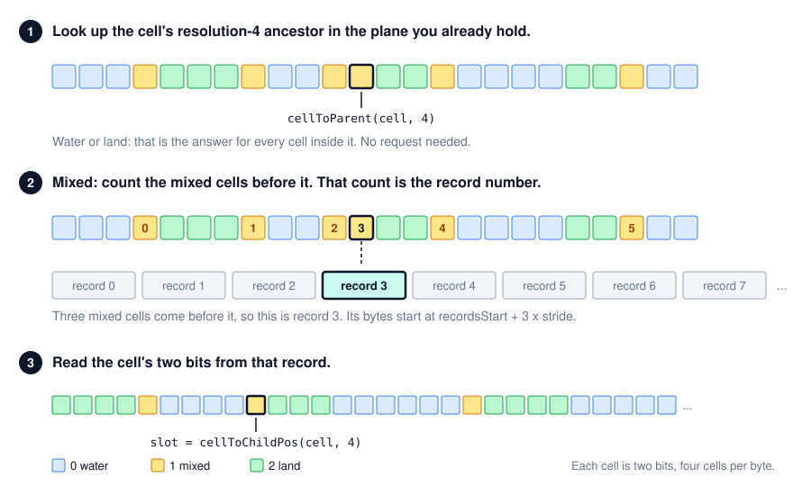

# H3 land occupancy

A global answer to “is this H3 cell water, land, or both?”, readable with HTTP range requests. The file format is **H3LD** (H3 land data).

Published archives:

```
https://tiles.seasketch.org/h3-land/v1/land-res8.h3ld
https://tiles.seasketch.org/h3-land/v1/land-res9.h3ld
```

Resolution 8 is about 9.7 MB. Opening either file downloads the resolution 0–4 planes, about 84 KB. After that, a search pays one record the first time it enters a mixed resolution-4 cell (601 bytes at resolution 8, 4,202 bytes at resolution 9), and nothing for open ocean or a solid continent. The files are cached as immutable. A later build is a new URL.

The two archives share the same planes. The resolution-9 file is the same layout with a finer record: 16,807 slots instead of 2,401. The header is the source for the stride and the fine resolution.

## Specification

An H3LD (H3 land data) file has three parts, in this order:



- **Header.** 28 bytes. Says which resolutions the file covers and where the records start.
- **Planes.** The state of *every* H3 cell at resolutions 0, 1, 2, 3 and 4, two bits per cell. About 84 KB. A reader downloads this once and keeps it in memory.
- **Records.** The detail along coastlines. For every resolution-4 cell that is **mixed** (part water, part land), one record holds every cell at the file's fine resolution inside it. The header gives the size: 601 bytes at resolution 8, 4,202 bytes at resolution 9. Records are the rest of the file and are fetched one at a time, on demand.

Every cell has one of three states:

| Value | State | Meaning |
| --- | --- | --- |
| 0 | water | Every finer cell inside is water. |
| 2 | land | Every finer cell inside is land. |
| 1 | mixed | The shoreline passes through. Look closer, or fetch the polygon. |

Value 3 is unused. A parent is water only if all of its children are water, and land only if all of them are land, so water and land are safe to act on at any resolution. Mixed is undecided: treating it as land will block a channel, and treating it as water can route across a point.

The reason this works: a resolution-4 cell is about 22 km across, and most of them are either open ocean or solid land. The plane already answers those, so none of their descendants need to be stored. In the resolution-8 archive, 16,001 of 288,122 resolution-4 cells are coastal and have a record. A resolution-9 archive can mark more of those cells mixed, because a channel that disappears inside a 460 m cell can still show up at 174 m. The record count is in the header either way. Every record is the same size and they appear in the same order as the cells in the resolution-4 plane, so a reader computes the byte offset from the plane it already has. There is no index to download.

### Looking up a cell



1. **Find the cell's resolution-4 ancestor** with `cellToParent(cell, 4)` and read its two bits from the resolution-4 plane. If it is water or land, that is the answer for the cell you asked about. Stop. Nothing was downloaded.
2. **If it is mixed, count the mixed cells that come before it in the plane.** That count is the record number. The record's bytes begin at `recordsStart + recordNumber × stride`. Fetch `stride` bytes. That is 601 in the resolution-8 file and 4,202 in a resolution-9 file.
3. **Read the cell's two bits from the record.** Its slot is `cellToChildPos(cell, 4)`, its position among the parent's `7^(fine − 4)` descendants at the file's fine resolution. That is 2,401 at resolution 8 and 16,807 at resolution 9.

For a cell coarser than the fine resolution and finer than 4, step 3 changes. Those resolutions are not stored. Read the fine slots inside the cell: a run of `7^(fine − res)` slots starting at `cellToChildPos(cell, 4) × 7^(fine − res)`. All water is water. All land is land. Anything else is mixed. In a resolution-9 file that is how resolution 8 is answered too: seven resolution-9 slots per resolution-8 cell. For resolution 4 and coarser, the planes are the answer directly.

#### Worked example, resolution-8 archive

The resolution-8 cell under the Golden Gate Bridge is `8828308703fffff`.

1. Its resolution-4 ancestor is `8428309ffffffff`. That cell is number 47,518 in the plane. Two bits at that position hold `01`: **mixed**. The cell covers the bay and the headlands, so this is expected.
2. 5,165 mixed cells come before it in the plane. The record starts at byte 84,083 + 5,165 × 601 = 3,188,248.
3. `cellToChildPos("8828308703fffff", 4)` is 638. Bits for slot 638 are in byte 159 of the record (638 ÷ 4), at bit 4 (638 mod 4 = 2, times two bits). They hold `00`: **water**. The bridge spans open water.

A resolution-8 cell in downtown San Francisco, `8828308287fffff`, shares the same ancestor and the same record. Its slot is 248, byte 62, bits 0–1, which hold `10`: **land**. The second lookup cost no request; the record was already in memory.

A cell 100 km offshore has ancestor `8428351ffffffff`, whose plane value is `00`: water. Done at step 1.

### Byte layout

All integers are little-endian.

**Header**, 28 bytes:

| Offset | Type | Field | Resolution 8 | Resolution 9 |
| --- | --- | --- | --- | --- |
| 0 | char[4] | magic, `H3LD` (H3 land data) | `H3LD` | `H3LD` |
| 4 | u8 | format version | 1 | 1 |
| 5 | u8 | fine resolution, the finest cell stored | 8 | 9 |
| 6 | u8 | coarse resolution, the last plane | 4 | 4 |
| 7 | u8 | first plane | 0 | 0 |
| 8 | u8 | bits per cell | 2 | 2 |
| 9 | u8[3] | reserved, zero | | |
| 12 | u32 | slots per record, `7^(fine − coarse)` | 2,401 | 16,807 |
| 16 | u32 | record stride in bytes, `ceil(slots × 2 / 8)` | 601 | 4,202 |
| 20 | u32 | number of records | 16,001 | in the file |
| 24 | u32 | `recordsStart`, byte offset of the first record | 84,083 | 84,083 |

A reader should require the magic, version 1, and coarse resolution 4, and take everything else from the header rather than hard-coding it.

**Planes.** Immediately after the header come five planes, resolutions 0 through 4. Each plane is a `u32` cell count followed by the states, packed four cells per byte. The first cell is in the low two bits of the first byte, the second cell in the next two bits, and so on:

```
state = (bytes[i >> 2] >> ((i & 3) * 2)) & 3
```

Cells within a plane are ordered by base cell (0 through 121), and within a base cell by `cellToChildPos(cell, 0)`. So a cell's position is the number of cells that belong to earlier base cells, plus its own child position. Pentagon base cells have fewer descendants than hexagons, so build that table from h3-js once, with `cellToChildrenSize(res0Cell, res)` for each of the 122 res-0 cells. The cell count in each plane must equal `getNumCells(res)`.

| Plane | Cells | Bytes incl. count | Starts at |
| --- | --- | --- | --- |
| 0 | 122 | 35 | 28 |
| 1 | 842 | 215 | 63 |
| 2 | 5,882 | 1,475 | 278 |
| 3 | 41,162 | 10,295 | 1,753 |
| 4 | 288,122 | 72,035 | 12,048 |

The planes end at byte 84,082, and `recordsStart` is 84,083.

**Records.** One per mixed resolution-4 cell, in plane order, each exactly `stride` bytes. A record is `slots` two-bit values with the same packing as the planes, indexed by `cellToChildPos(cell, 4)`. The twelve pentagon base cells have fewer children than a hexagon, so the tail of a pentagon's record is unused and holds water.

| Fine resolution | Hex slots | Pentagon slots | Stride |
| --- | --- | --- | --- |
| 8 | 2,401 | 2,001 | 601 |
| 9 | 16,807 | 14,006 | 4,202 |

### Fetching over HTTP

Two kinds of request are all a reader needs. First, the prefix, once:

```
Range: bytes=0-84082          (bytes=0-{recordsStart - 1})
```

Then individual records, or one request for a run of records that are adjacent in the file:

```
Range: bytes=3188248-3188848  (bytes={offset}-{offset + stride - 1})
```

Responses are `206 Partial Content` with `Content-Range`. `tiles.seasketch.org` sends `Accept-Ranges: bytes` and allows these requests from SeaSketch hosts and from localhost. The file is immutable, so both the prefix and the records can be cached for as long as you like.

## Client

`openLandOccupancy` is the reader for that file. Node code can import it from `@seasketch/h3-land`. A browser bundle should import `@seasketch/h3-land/client`, which does not load the sqlite builder. `viewer/index.html` still has its own range reader.

```ts
import { openLandOccupancy } from "@seasketch/h3-land/client";
import { latLngToCell } from "h3-js";

const land = await openLandOccupancy(
  "https://tiles.seasketch.org/h3-land/v1/land-res8.h3ld"
);

await land.state(latLngToCell(37.8, -122.48, 8));
// "water" | "mixed" | "land"
```

The client does not fetch a single record. About 80% of mixed resolution-4 cells that share an edge are at most 14 records apart, so the default block is 16 records: one fetch covers that neighborhood, and the block is the cache unit. Sixteen records are 9,616 bytes in the resolution-8 archive and 67,232 bytes in a resolution-9 archive, because the stride grew from 601 to 4,202. The block is a count of records, not a byte budget, so a finer file does not collapse to a handful of cells. Every block starts at `recordsStart + blockIndex * blockRecords * stride`, and the last block stops at the last record.

A call that needs several blocks fetches the span in one request when the hole between them is at most `coalesceGap` records. The default gap is one block. `cacheBytes` (default 32 MiB) is the most record data kept after the call returns. The planes stay for the life of the object and do not count. `cacheBytes: 0` drops records at the end of each call. Blocks a call is still reading stay pinned, including when two callers share one in-flight request.

```ts
type LandState = "water" | "mixed" | "land";

interface LandOccupancy {
  /** The URL passed to openLandOccupancy, or null for an in-memory archive. */
  readonly source: string | null;
  /** 4. Uniform cells at this resolution have no fine record. */
  readonly coarseResolution: number;
  /** 8 or 9. The finest cell the file can answer directly. Read it from the header. */
  readonly fineResolution: number;
  readonly stride: number;
  readonly slots: number;
  readonly blockRecords: number;
  readonly stats: {
    requests: number;
    bytes: number;
    records: number;
    hits: number;
  };

  /** One cell, at any resolution from 0 through fineResolution. */
  state(cell: H3Index): Promise<LandState>;

  /**
   * Many cells. Mixed coarse parents are grouped into record-aligned blocks,
   * and blocks that sit near each other become one range request.
   */
  states(cells: Iterable<H3Index>): Promise<Map<H3Index, LandState>>;

  /**
   * The children of a cell and their states. A water or land cell returns
   * copies of that state and does not download a record. A pentagon has six
   * children; every other cell has seven.
   */
  split(cell: H3Index): Promise<Array<{ cell: H3Index; state: LandState }>>;

  /**
   * Download the blocks that cover these cells. Water and land parents are
   * skipped. Cells may be any resolution up to the fine resolution.
   */
  prefetch(cells: Iterable<H3Index>): Promise<void>;

  /** Drop cached records. The planes stay. */
  clearCache(): void;
}

function openLandOccupancy(
  url: string,
  options?: LandOccupancyOptions
): Promise<LandOccupancy>;

function openLandOccupancyBytes(
  bytes: Uint8Array,
  options?: LandOccupancyOptions
): LandOccupancy;
```

`state` at resolution 4 or coarser reads the planes kept in memory. A finer cell looks at its resolution-4 parent. Water or land answers every descendant with no further request. Mixed loads that parent's block, then answers every resolution from 5 through the fine resolution by folding slots. See the specification for the byte ranges.

`stats.requests` and `stats.bytes` count range requests and the bytes asked for. `stats.records` is how many fine records are in the cache now. `stats.hits` counts blocks served from memory. The same counters belong next to the water-path timings.

Hold one `LandOccupancy` for the life of the worker or the page. The planes and the records are immutable, and a second search in the same region should add no requests. `openLandOccupancy` may be called again for a different URL, including the resolution-9 archive. Do not share one instance across two URLs. `fineResolution` and the record stride come from that file's header.

`openLandOccupancyBytes` opens a file that is already in memory. Pass `options.read` to supply the range reader yourself: tests do this, and so would a caller that already has a socket. The default reader sends `Range: bytes=start-end` (end inclusive). Other options are `cacheBytes`, `blockRecords`, `coalesceGap`, `concurrency` (default 6), and `signal`.

## Ocean pathfinding

The overlay-engine water routers ask one question over and over: is this H3 cell traversable? Today the hierarchy search (`waterPathHierarchy.ts`) answers it from the land FlatGeobuf. An R-tree miss is water. Any hit below resolution 8 is treated as land and split, because a bounding box cannot tell a solid continent from a shoreline. At resolution 8 the cell center is tested against the polygons that meet the cell. The hex router in `waterPathNearestH3.ts` does the same split, and calls a fine mixed cell passable when its center is in the water. Both use coarse resolution 4 (~22 km edge) and fine resolution 8 (~460 m edge).

The occupancy file replaces the yes/no part of that test. The polygon fetch remains only for a mixed cell at the file's fine resolution. With the resolution-8 archive that is still resolution 8. With a resolution-9 archive the same test runs on a cell about 174 m across, and a resolution-8 question is answered by folding seven of those cells. The search graph does not have to move to resolution 9 to use the file.

```ts
import { cellToParent, getResolution } from "h3-js";

const COARSE = 4;
const FINE = land.fineResolution;

async function cellIsWater(cell: H3Index): Promise<boolean> {
  const state = await land.state(cell);
  if (state === "water") return true;
  if (state === "land") return false;
  if (getResolution(cell) < FINE) return false; // caller splits
  const features = await landPolygonsTouching(cell);
  const [lat, lng] = cellToLatLng(cell);
  return !features.some((feature) => pointOnFeature([lng, lat], feature));
}
```

`false` below the fine resolution means “do not cross this cell at this resolution.” The hierarchy already splits those cells. `split` is the same step with the states attached, so a child that is `water` can be entered and a child that is `land` can be dropped before the next round.

Lifting a fine cell up to the largest water ancestor is a walk of `state` on parents. Those reads hit the in-memory planes until the walk enters a mixed resolution-4 cell.

Before the search, prefetch the coarse disk. A 200 mile disk is a few hundred resolution-4 cells, and only the mixed ones become requests:

```ts
const disk = polygonToCells(searchRing, COARSE, true);
await land.prefetch(disk);
```

A segment test for the tangent router is the same three outcomes, applied to the cells the segment crosses:

- Every cell `water`: the segment does not meet land. Skip shoreline geometry.
- Any cell `land`: the segment is blocked.
- A `mixed` cell at the file's fine resolution: test the segment against the shoreline polygons for that cell.

Offshore tangents, which are most of the visibility graph, stay on the first branch. The land index does not have to be opened to learn that.

Prefetch still matters for the tangent router. The cells a long segment might cross are known before the segment is tested. One `states` call loads those records, and later segments reuse them.

What stays on the FlatGeobuf:

- The shoreline rings for fine `mixed` cells whose center or edge you still have to test.
- Ports, and any metric that needs a real distance to shore rather than a cell state.

What goes away for the occupancy question is the 44 MB land R-tree, and the coarse cells that were split only because some polygon’s bounding box overlapped them.

## Other uses

**A point.** `state(latLngToCell(lat, lng, land.fineResolution))`. Use a coarser resolution when a 22 km answer is enough. A resolution-4 `water` cell is a definitive ocean answer. On a resolution-9 file, resolution 8 is still a direct answer: the client folds seven slots and does not require a second record.

**A line or a polygon.** Cover it with `polygonToCells` at the coarsest resolution that changes the decision, then `states`. Step one resolution finer only inside the `mixed` cells. That is the same walk as the pathfinder, without a destination.

**A mask for another metric.** Drop cells that are `land` before running an overlay that only makes sense on water. Keep `mixed` cells in the job, because part of them is water. Skipping `mixed` cells will miss the shoreline the metric was probably asked about.

**A map.** Color cells from `states` over the viewport, and choose the resolution from the zoom. The viewer does this. `water` should stay faint; the interesting band is `mixed`.

**A batch of candidate harbors or sample points.** Resolve them all in one `states` call. Adjacent harbors share a resolution-4 parent and then share one record.

## Reading efficiently

Ask at the coarsest resolution that changes the decision. A query whose resolution-4 parent is `water` or `land` never needs the fine record, at resolution 8 or 9. Most of the globe is in that group. In the resolution-8 archive, 196,218 of 288,122 resolution-4 cells are water and 75,903 are land. The other 16,001 are mixed, and they contain every partial resolution-8 cell (1,837,466 of them) plus the land and water cells along that coast.

Fetch those records in groups. `prefetch` and `states` load blocks of 16 records and merge blocks with at most one block of records between them, so a stretch of coastline is a handful of requests rather than one request per cell. Calling `state` in a loop also works, because the second call for the same block is a cache hit, but cells that land in different blocks become separate requests unless one `states` call sees them together.

Cache for the session. A worker that runs many sketches should keep the `LandOccupancy` on the source object, the same way feature pages of the land FlatGeobuf are reused. The first sketch in a region pays for the records. The next one should report `stats.requests` unchanged.

Do not scan a fine record to rediscover a coarse answer. If you need the children of a mixed cell, call `split` once and keep the result for that expansion. A pentagon returns six; every other cell returns seven.

On a resolution-9 archive the calls are the same. Prefetch still skips uniform parents. A resolution-8 question folds seven slots out of the 4,202-byte record, so a router that searches at resolution 8 does not download a second file. Each record is seven times as long, so a 16-record block is about 67 KB instead of about 10 KB. It still covers the same number of resolution-4 parents, and a merged range still covers a stretch of coastline in a handful of requests.

Cells past the antimeridian need no special case. The key is an H3 index, not a longitude range.

## Failure and conservatism

A missing archive, a magic mismatch, or a plane cell count that is not H3’s `getNumCells` is a hard error. Do not guess water.

If a fine record fails to load, fail the cells inside that parent. Answering `water` for them will route through land. Answering `mixed` and splitting forever will not terminate. Surface the failed range and let the caller retry.

`land` at a coarse resolution means every fine descendant was entirely covered, including cells that only became land once neighboring subdivision pieces were added together. A cell that is 99.9% land is stored as `land`. Real channels are wider than that fraction of a cell at the file's fine resolution. A sliver thinner than that can disappear. Resolution 9 keeps cuts that resolution 8 would have called land. If a route depends on a cut narrower than the fine cell, it still belongs in the polygon test, which means the cell has to have remained `mixed`.

Building and republishing the archive is described in [MAINTAINING.md](./MAINTAINING.md).
